<p align="center">
  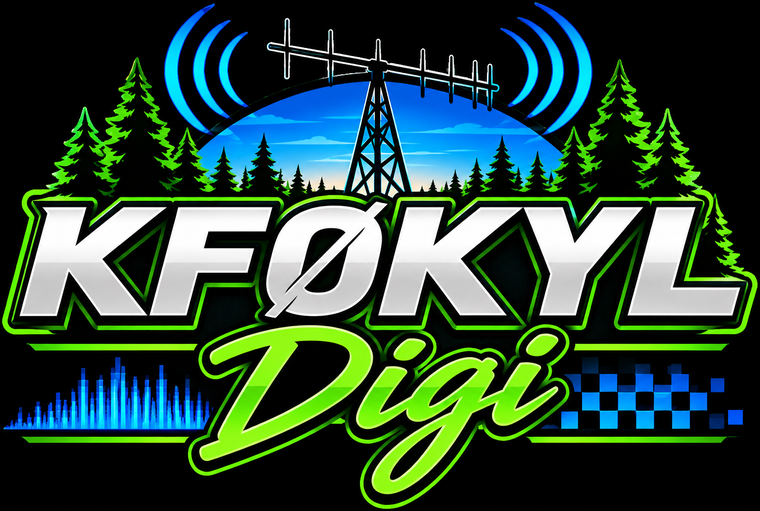
</p>

<h1 align="center">KF0KYL Digi</h1>

<p align="center">
  <b>Everything you love about WSJT-X, with the station dashboard you always wanted.</b><br>
  Same decoders · modern look · seven colour schemes · live band conditions and VOACAP map · QRZ built in
</p>

<p align="center">
  <a href="https://github.com/ccoo26/KF0KYL-Digi/releases/latest"><b>⬇ Download the latest release</b></a>
</p>

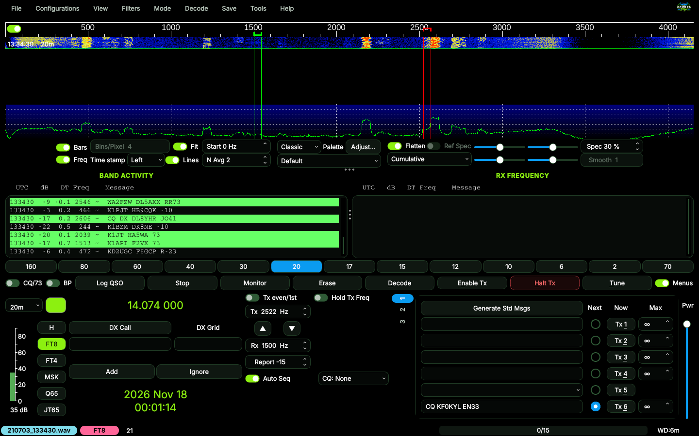

KF0KYL Digi is built on **WSJT-X 3.0.2** by Joe Taylor, K1JT, and the WSJT Development Team.
Under the hood it decodes and transmits **exactly like WSJT-X**: same modes, same decoders,
same rig control. Everything else, the parts you look at and click all evening, has been
rebuilt to be easier on the eyes and to put more of your station in front of you.

> **Not the official WSJT-X.** KF0KYL Digi is an independent, unofficial version and is
> not endorsed by the WSJT Development Team. Please report problems with it
> [here on GitHub](https://github.com/ccoo26/KF0KYL-Digi/issues), not to the WSJT-X groups.

---

## Why KF0KYL Digi?

| | WSJT-X | KF0KYL Digi |
|---|:---:|:---:|
| FT8, FT4, JT65, Q65, MSK144, WSPR and the rest | ✅ | ✅ same decoders |
| Works with JTAlert, GridTracker, Log4OM, N1MM+ | ✅ | ✅ |
| Modern look with dark mode and 7 colour schemes | | ✅ |
| Waterfall built into the main window, with SDR and 3D styles | | ✅ |
| Layouts you can drag and resize | | ✅ |
| Live space weather, solar images and NCDXF beacons | | ✅ |
| World map of everyone you're hearing, with gray line and aurora | | ✅ |
| VOACAP propagation for your power and mode, painted on the map | | ✅ |
| Worked stations and worked grids on the map, today or all time | | ✅ |
| Lines to the stations that heard you (PSK Reporter) | | ✅ |
| Tells you about new versions and downloads them | | ✅ |
| Click a station on the map to call it | | ✅ |
| Automatic upload to your QRZ Logbook, no duplicates | | ✅ |
| Name, location and QRZ photo of the station you're working | | ✅ |
| **Max tries** limit on every Tx message | | ✅ |
| Installs alongside WSJT-X and copies your settings over | | ✅ |
| Free | ✅ | ✅ |

---

## 🎨 Seven colour schemes

Pick one from **View → Color Scheme**. Every window follows along, including the waterfall
controls, Settings and the Conditions window.

| | |
|---|---|
| **Digi Green** *(new default)*: black, blue, lime and white. High contrast and easy to read across the room. |  |
| **Dark**: the classic dark mode, with a dark Windows title bar to match. | 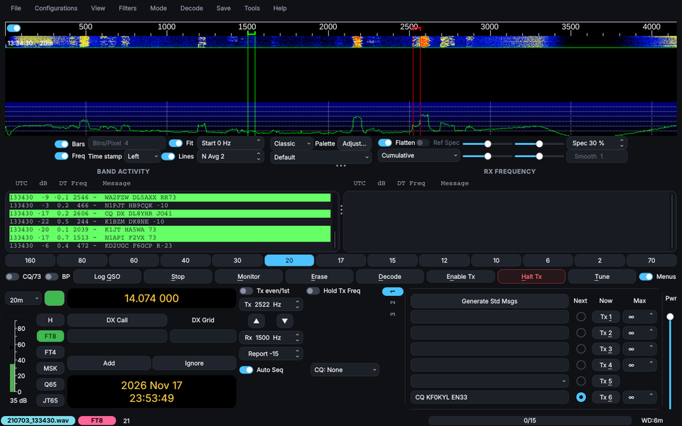 |
| **Midnight Blue**: deep navy, softer than black. | 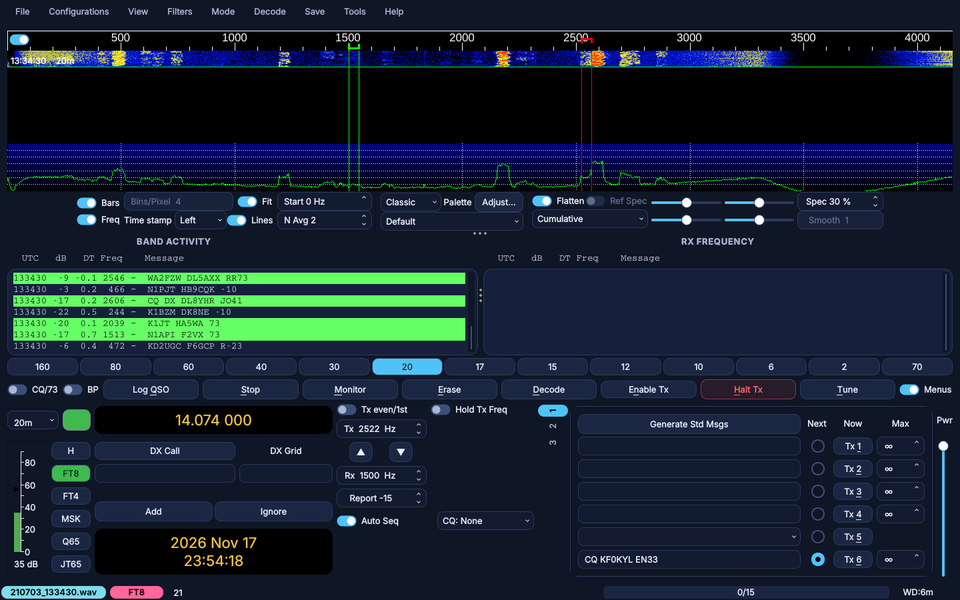 |
| **Night Red**: all red on black, so your eyes stay adjusted for night or field operating. | 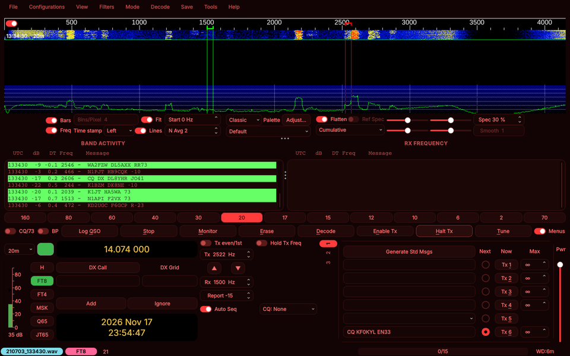 |
| **High Contrast**: maximum contrast for bright rooms or tired eyes. | 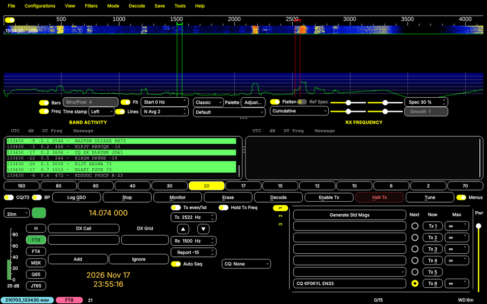 |
| **Light**: clean and bright for daytime. | 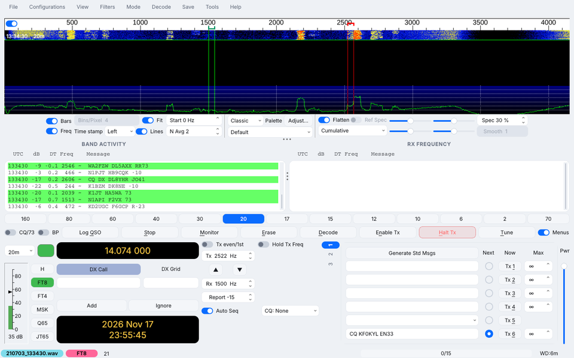 |
| **Paper**: warm, easy-on-the-eyes daytime look. | 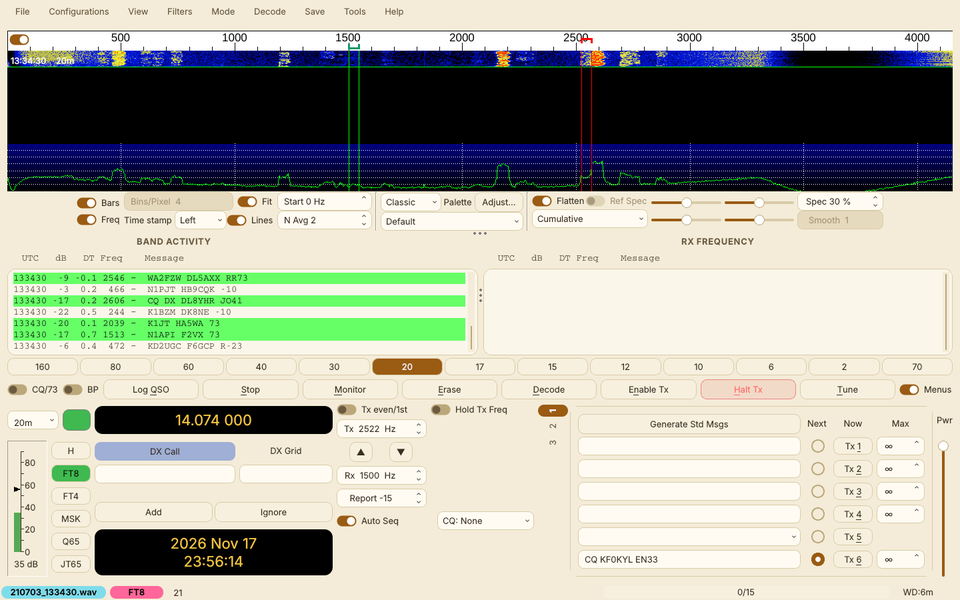 |

Upgrading? You keep the scheme you already had. New installs start in Digi Green.

The look itself is new throughout: rounded buttons, sliding switches, pill tabs and status
tags. Highlighted decode lines automatically pick black or white text so they're readable
in any scheme. You can also choose your own colours for the big frequency and clock
displays in **File → Settings → Colors**.

---

## 🌍 The Conditions window: your station dashboard

Open **View → Conditions…** and you get a full-screen dashboard of what the bands are
doing *right now*, next to the stations you're actually decoding.

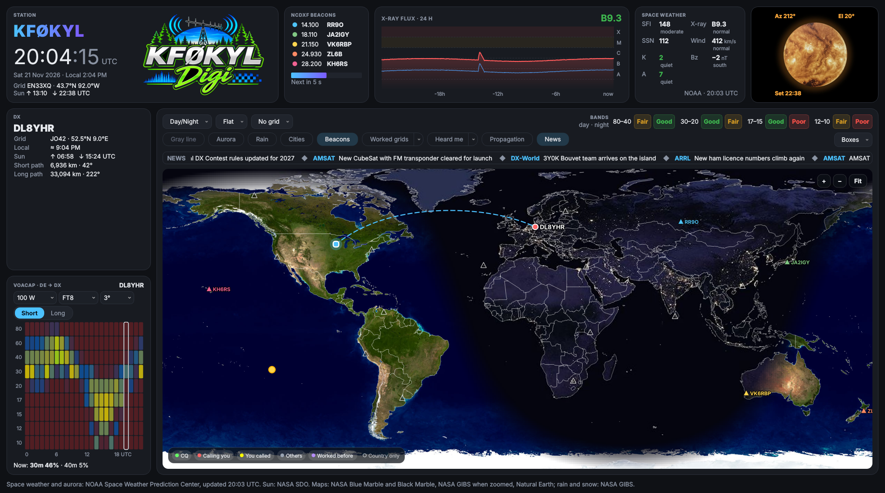

Turn each box on or off from the **Boxes** menu, and the rest grow to fill the space.

- **Station:** your call, big UTC clock and local time, with your logo or picture beside
  it. Double-click it to pick the KF0KYL Digi logo, your own picture, or none.
- **Space weather:** solar flux, sunspots, K and A index, X-ray, solar wind and Bz from
  NOAA, plus a 24-hour X-ray graph.
- **The Sun:** live NASA SDO images in visible light and several ultraviolet channels.
- **NCDXF beacons:** which of the 18 beacons is sending on each band this second.
- **DE and DX:** grid, local time, sunrise and sunset for you and the station you're
  working, with distance and beam heading on short and long path.

### The map

- **Styles:** Day/Night satellite, Satellite, Countries and Terrain. Zoom in and it loads
  sharp NASA imagery and crisp coastlines and borders.
- **Flat or Centred on you** (azimuthal, so straight lines are beam headings).
- **Zoom and pan** with the mouse or the + / − / Fit buttons.
- **Overlays:** gray line, NOAA aurora forecast, rain and snow from NASA satellites,
  NCDXF beacons, city names, and Maidenhead or lat/long grids.
- **Every station you've heard in the last 30 minutes** is plotted in its Band Activity
  colour: calling CQ, calling you, you called, or everyone else.
- **Double-click a station on the map to call it.**
- Point anywhere to see the nearest city, the grid square, and the distance and heading
  from you.

### 📡 VOACAP propagation, built in

No website, no separate program. KF0KYL Digi runs the VOACAP engine itself.

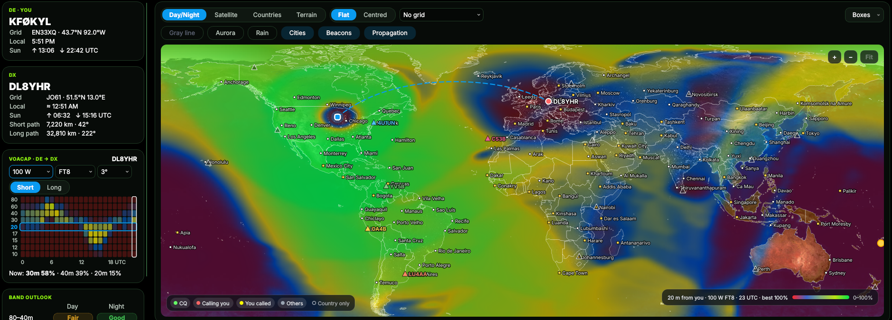

- **DE → DX chart:** pick your power (5 W to 1500 W, including 15 W and 20 W for QRP),
  your mode (FT8, FT4, WSPR, CW or SSB) and your takeoff angle. You get a 24-hour chart of
  every band to the station you're working, short path or long path.
- **Band map:** click a band and the map paints where your signal can be heard from your
  location. **Green means you'll be heard**, fading through yellow and blue down to
  **red where the band is closed**.

---

### 🟣 Worked stations, worked grids and who heard you *(new in 1.2.1)*

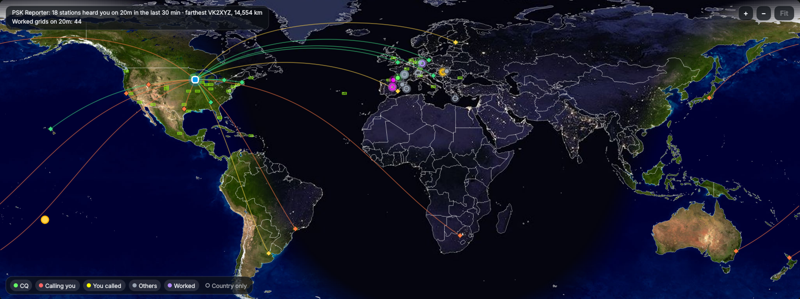

- **Worked:** stations already in your log on this band get their own colour. Click the
  **Worked** chip in the legend to switch between *Worked before*, *Worked today* and hidden.
- **Worked grids:** shades every grid square you've logged on the band, or just today's.
- **Heard me:** a line to every station that reported hearing you in the last 30 minutes,
  from PSK Reporter. Green is a strong signal, yellow fair, orange weak; a key on the map
  explains it, and pointing at a station shows its call, dB and distance.

## 📈 A better waterfall

- **Built into the main window**, so there's one window to manage. Prefer it on a second
  monitor? Untick **View → Waterfall in Main Window**.
- **Three styles:** Classic, **SDR** (big spectrum with grid and peak hold) and **3D**.
- **New palettes:** Ocean, Inferno, Aurora, NightVision, Mono and Violet.
- **Fit** squeezes the whole band into the space you give it, at any width.

## 🧩 Layouts you can arrange

Pick from **View → Layout** and drag the dotted grips to size each section. Each layout
remembers its own sizes.

- **Classic:** waterfall on top, Band Activity and Rx Frequency side by side.
- **Big Band Activity:** a tall Band Activity on the left, with everything else on the right.
- **Wide Screen:** for wide monitors, with Band Activity running top to bottom.

Windows always open fully on your screen, never hidden under the taskbar, and big text
sizes scroll instead of pushing controls off the edge.

## ☁️ QRZ, built in

- **Automatic QRZ Logbook upload.** Every contact goes up the moment it's logged. It never
  sends the same QSO twice, and if your internet is down it waits and retries.
- **See who you're working.** Name, city, state or country, grid, licence class and QRZ
  photo appear under the decodes, with a button to open their QRZ page. US calls are filled
  in from FCC data even without a QRZ login.

## 🛑 Max tries on every message *(new)*

Ever left a CQ running into a dead band, or kept calling a station that faded out ten
minutes ago? Each Tx message now has a **Max** box right on the main screen, beside
Tx1–Tx4 and Tx6.

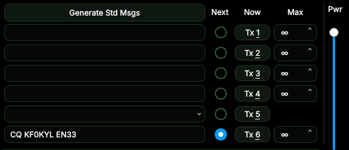

- Set how many times in a row a message may go out **with no reply**, from 1 to 99,
  or ∞ for no limit (the way WSJT-X has always worked).
- When it reaches the limit, KF0KYL Digi turns off **Enable Tx** before keying up
  again and tells you in the status bar, e.g. *"Stopped calling CQ after 5 calls with
  no answer"*.
- Set CQ to, say, 5 tries and your reply or report to 3, and you'll never find
  yourself calling into nothing again.
- The count starts over as soon as the message changes (the other station answered
  and Auto Seq moved on) or when you turn Enable Tx back on.
- Your limits are remembered between sessions.

## 🔎 Filters for what you want *(new in 1.2.1)*

At the top of the **Filters** menu:

- **Show only new DXCC and grids on this band** hides everyone whose country and grid
  you've already got on the band, the way GridTracker does.
- **Hide signals weaker than** a level you pick, from −20 to 0 dB.

Anything sent to you always shows, whatever the filters say.

## 🔔 A sound when you log, and updates that find you *(new in 1.2.1)*

- **Tools → Sound when a QSO is logged…** plays a .wav file of your choice through your
  computer's speakers each time a contact goes in the log.
- **Help → Check for updates…** and a quiet check when the program starts (once a day,
  and you can turn it off). When a new version is out you see what's new and can download
  it right there. On Windows, KF0KYL Digi closes and the installer starts; on Linux and the
  Pi the file is saved and you get the one-line install command.

## 🧳 Lives alongside WSJT-X

KF0KYL Digi keeps its own settings and log, so you can keep the official WSJT-X installed
too. **The first time it starts, it copies your WSJT-X settings, log and history over**, so
there's nothing to set up again.

---

## Download and install

Get the files from the **[Releases page](https://github.com/ccoo26/KF0KYL-Digi/releases/latest)**.

| You have | Download |
|---|---|
| Windows 10 / 11 (64-bit) | `kf0kyldigi-…-windows-x86_64` installer (`.exe`) |
| Raspberry Pi 4 / 5 (or 3B+) | `kf0kyldigi-…-linux-aarch64.deb` |
| Linux PC | `kf0kyldigi-…-linux-x86_64.AppImage` or `.deb` |

### Windows
1. Run the installer. Windows may say it *"protected your PC"* because the installer isn't
   code-signed. Click **More info → Run anyway**.
2. Start **KF0KYL Digi** from the Start menu. It installs under `C:\KF0KYL` and does not
   replace an existing WSJT-X.

### Raspberry Pi
You need the **64-bit** Raspberry Pi OS based on Debian 13 "Trixie" (or Ubuntu 24.04).
Check with `uname -m` (should say `aarch64`).

```bash
sudo apt update
sudo apt install ./kf0kyldigi-*-linux-aarch64.deb
```

It appears in the main menu (usually under **Sound & Video**) as **KF0KYL Digi**. On Linux
it replaces the official `wsjtx` package (they share program files), so the two can't be
installed at the same time.

Pi tips: a Pi 4 or 5 is comfortable (use **Decode → Deep** freely); a Pi 3B+ works with
**Decode → Normal**. Make sure the clock is synchronised (`timedatectl` should say
*System clock synchronized: yes*) and use a USB sound card or your rig's USB audio.

---

## Setting up the QRZ features

Open **File → Settings → Advanced**:


- **Upload QSOs to QRZ Logbook:** tick it and paste your *Logbook API key* from
  QRZ.com → My Logbook → Settings, then click **Test Key**. QRZ requires a subscription
  for logbook uploads, and the station callsign in KF0KYL Digi must match the logbook.
- **Callsign lookup on QRZ.com:** enter your QRZ username and password and click
  **Test Login**. It tells you whether your account gets full or limited data.

Your key and password are stored only in KF0KYL Digi's settings file on your computer.

---

## Works with your other ham software

Everything else works just like WSJT-X 3.0.2, and the
[WSJT-X User Guide](https://wsjt.sourceforge.io/wsjtx.html) applies. Programs that talk to
WSJT-X over UDP (JTAlert, GridTracker, loggers such as Log4OM and N1MM+) work as usual.
They see the program name *KF0KYL Digi* and the WSJT-X version it's based on.
PSK Reporter spots are identified as KF0KYL Digi.

---

## Questions

**Is it safe to run alongside WSJT-X?** Yes on Windows: separate install folder, settings
and log. Just don't run both on the same radio at the same time.

**Does the Conditions window use my internet all the time?** No. It only fetches while
it's open: space weather every 15 minutes, rain and snow every 30. VOACAP runs on your
own computer.

**Where are my settings?** Windows: the `%LOCALAPPDATA%\KF0KYL Digi\` folder holds
`KF0KYL Digi.ini` and your log, ALL.TXT and QRZ upload history. Linux:
`~/.config/KF0KYL Digi.ini` and `~/.local/share/KF0KYL Digi/`. Use
**File → Open log directory** to jump there.

**My WSJT-X settings didn't come over.** They're copied only on the very first start. To
copy them by hand, close KF0KYL Digi, then copy `%LOCALAPPDATA%\WSJT-X\WSJT-X.ini` into
`%LOCALAPPDATA%\KF0KYL Digi\` and rename it to `KF0KYL Digi.ini`. Copy `wsjtx_log.adi` and
`qrz_uploaded.txt` too.

**Found a bug or have an idea?** Open an
[issue](https://github.com/ccoo26/KF0KYL-Digi/issues).

---

## Credits

KF0KYL Digi stands on the work of the WSJT Development Team (WSJT-X), the VOACAP authors
and the voacapl project, NOAA's Space Weather Prediction Center, NASA (SDO, Blue Marble,
Black Marble and GIBS) and Natural Earth. Thank you.

## ☕ Buy me a coffee

KF0KYL Digi is free and always will be. If it's made your time on the air more fun
and you'd like to say thanks, you can buy me a coffee here:

**Venmo:** [@Carson-Coordes](https://venmo.com/u/Carson-Coordes)

73, Carson KFØKYL

## Building from source

Every push to this repository is built automatically by GitHub Actions for Windows, Linux
x86-64 and Linux ARM64 (see `.github/workflows`). To build locally, follow the WSJT-X
build instructions in [INSTALL](INSTALL); nothing extra is needed.
