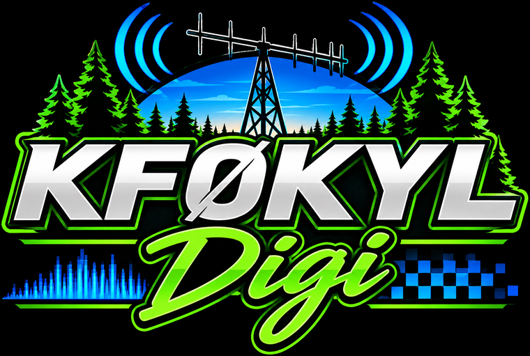
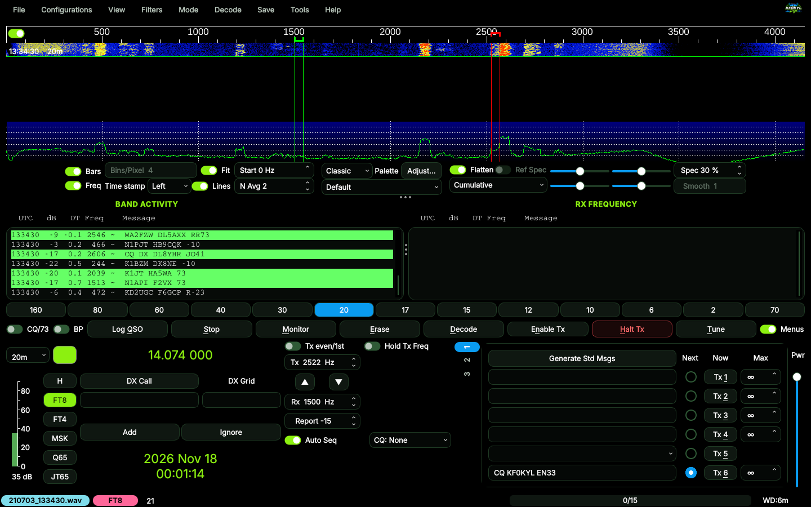
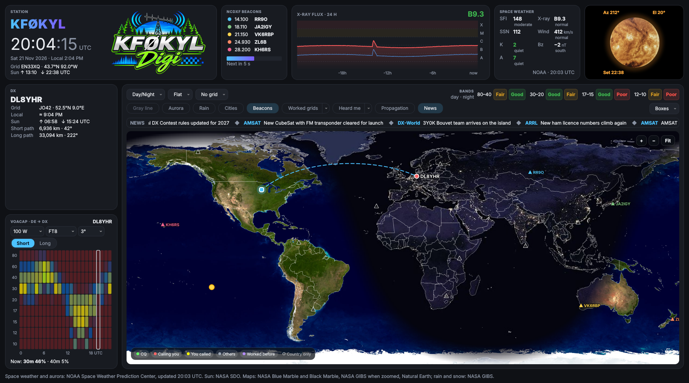

# KFØKYL Digi User Guide

KFØKYL Digi is a modernised version of WSJT-X for FT8, FT4 and the other WSJT modes. The decoding is WSJT-X's own, unchanged. What's new is the look, the layout and the tools around it: a built-in waterfall, QRZ lookups and logbook upload, a Conditions window with live maps and space weather, and more.

This guide covers what KFØKYL Digi adds. For how the modes themselves work (FT8 sequencing, DXpedition mode, Q65 and so on), see the **WSJT-X mode guides** in the Help menu and the [WSJT-X User Guide](https://wsjt.sourceforge.io/wsjtx-main_en.html).

**Contents**

1. [Getting started](#getting-started)
2. [The main window](#the-main-window)
3. [Band Activity, colours and filters](#band-activity-colours-and-filters)
4. [Calling and answering](#calling-and-answering)
5. [The waterfall](#the-waterfall)
6. [QRZ](#qrz)
7. [The Conditions window](#the-conditions-window)
8. [Logging](#logging)
9. [Updates, problems and ideas](#updates-problems-and-ideas)
10. [Credits](#credits)

---

## Getting started

**Installing.** Download the installer for your computer from the [Releases page](https://github.com/ccoo26/KF0KYL-Digi/releases):

- **Windows:** the `win64` setup file.
- **Linux PC:** the `x86_64` AppImage or `.deb`.
- **Raspberry Pi (64-bit):** the `aarch64` AppImage or `.deb`.

Windows or your browser may warn that the file isn't commonly downloaded. Choose **Keep**, then **More info → Run anyway**.

**First run.** If WSJT-X is already set up on your computer, KFØKYL Digi copies its settings the first time it starts, so your radio, audio and call sign are ready to go. Otherwise, set them in **File → Settings** just as you would in WSJT-X:

- **General:** your call sign and grid square.
- **Radio:** your rig, CAT port and PTT method. Use **Data/Pkt** mode and **Fake It** split.
- **Audio:** your radio's USB audio codec for input and output.

**Keep your clock right.** FT8 needs your computer's clock within about a second. If most stations in Band Activity show a **DT** of −1.5 or worse, sync your clock (Windows: Settings → Time & language → Date & time → **Sync now**).

## The main window

**Layouts.** **View → Layout** offers Classic, Wide and Big Band Activity. Drag any divider to resize the panes; **Reset Layout** puts them back.

**Colour schemes.** **View → Color Scheme**: Digi Green (the default), Dark, Light, Midnight, Night Red, Paper and High Contrast.

**Text size.** Settings → General → Display has two size boxes: one for the program's text and one for the decodes in Band Activity and Rx Frequency. Windows stay on screen at large sizes.

**Display colours.** Settings → Colors lets you set the colours of the frequency and date/time displays as well as the decode highlights.

## Band Activity, colours and filters

**Colour key.** The strip beside Band Activity shows what each highlight colour means (CQ, new DXCC, new grid, LoTW user, worked before and so on).

- **Double-click a colour** in the key to change its highlight and text colour. The change shows on screen straight away.
- **Edit** opens the full list in Settings → Colors.
- Hide the key from its right-click menu; **View** brings it back.

**Filters.** The **Filters** menu hides stations you don't want to see:

- **Show only new DXCC and grids on this band**: hides stations whose country and grid are both already in your log on this band.
- **Hide signals weaker than** a chosen strength.
- The other WSJT-X Improved filters (continents, worked before, ignored calls and so on).

Filtered stations are hidden from Band Activity, Rx Frequency, the map and the waterfall calls. Anything sent to you, or from the station you're working, always shows. **BP** (bypass) turns all filters off at once.

**Logs that count as worked.** Filters → **Logs that count as worked...** adds other ADIF logs (an old log, or one from another program) so their QSOs count as worked too.

## Calling and answering

**Double-click a decode** to call that station, as in WSJT-X. Hold **Alt** to set it up without enabling Tx.

**Max tries.** The **Max** boxes beside Tx1–Tx4 and Tx6 set how many times each message is sent in a row with no reply before KFØKYL Digi stops. For example, 3 beside Tx6 stops calling CQ after three unanswered calls. **0** means no limit. These are hard stops: to try again, click **Enable Tx** yourself.

KFØKYL Digi never transmits on its own: there's no automatic answering of stations you didn't call.

## The waterfall

The waterfall is built into the main window. Its toolbar (**Tools** opens it, **Hide** closes it) has:

- **Views:** Classic, Waterfall, 3D, or Both.
- **Palettes:** Digi, Nebula and Default.
- **Gain, Floor and Speed** sliders.
- **Calls on signals:** shows each decoded call on its signal. **Double-click a call** on the waterfall to answer that station.
- **More** for the rest of the WSJT-X waterfall controls.

**Click** the waterfall to set your Rx frequency, **right-click** to set your Tx frequency.

## QRZ

Enter your QRZ details in **Settings** (the QRZ section): your QRZ XML login for lookups, and your Logbook API key for uploads. **Test Login** checks them.

- **Lookups:** the name, location and photo of the station you're working appear in the Conditions window's DX box, with a button to open their QRZ page.
- **Logbook upload:** each QSO you log is uploaded to your QRZ Logbook automatically, with no duplicates.

## The Conditions window

Open it from **View → Conditions...**

**The top bar**, left to right:

- **Station:** your call, the time in UTC and local, your grid and today's sunrise and sunset. The picture is yours to change (**Station picture** in its menu): a club logo, a QSL design or a photo.
- **NCDXF beacons:** which beacon is transmitting on each band right now. Hover for where each one is.
- **X-ray:** the Sun's X-ray level over the last 24 hours. M and X flares can black out HF on the daylight side.
- **Space weather:** solar flux (SFI), sunspots (SSN), K and A index, X-ray, solar wind and Bz, from NOAA. K and A are coloured green, yellow or red; X-ray, wind and Bz turn yellow or red when they're a worry. Hover over a reading for what it means.
- **The Sun:** NASA's latest picture of the Sun, with its direction (Az), height (El) and next rise or set from you. **Double-click it** to choose the picture, play the last two days as a movie, or open the gray line tool.

Choose which boxes show from **Boxes** on the map bar.

**DX box.** The station you're working: their call, QRZ name, place and photo, grid, local time, and short and long path. It keeps one size, so the VOACAP box below it never jumps around.

**VOACAP.** A propagation prediction from you to the station you're working: which bands are open, hour by hour, over the next day. Choose the transmit power it assumes.

**The map.**

- **Style:** Day/Night, Terrain and others. **Projection:** Flat, Azimuthal (centred on you) or Robinson.
- **Grid:** grid lines, CQ zones, ITU zones, the tropics, or beam headings.
- **Colour by:** Day/Night, or the band conditions: **MUF** (the highest usable frequency now, live from prop.kc2g.com) and **D-region absorption** (from NOAA). If prop.kc2g.com can't be reached, VOACAP's predicted MUF from you is shown instead, labelled as a prediction.
- **Fit** shows the whole world, pole to pole. Drag to move the map, and use the mouse wheel to zoom.
- **Stations** you decode appear on the map. **Double-click one** to call it.
- **Worked before / Worked today:** the stations and grids in your log, so you can see what's new.
- **Heard me:** lines to every station that reported hearing you on PSK Reporter, live as the reports come in, coloured by signal strength. Choose **This band** or **All bands**.
- **Map colours:** double-click any colour in the map's key to change it.

**News.** With **News** on, headlines scroll along the bottom of the map: news about KFØKYL Digi first, then ARRL, AMSAT and DX-World. Click a headline to read it.

## Logging

Log a QSO as in WSJT-X. KFØKYL Digi also:

- uploads it to QRZ Logbook (if set up),
- can play a sound of your choice (**Sound when a QSO is logged...**),
- marks the station and grid as worked on the map straight away.

## Updates, problems and ideas

- **Help → Check for updates...** looks for a newer version, and KFØKYL Digi also checks each time it starts. When there's one, it can download and start the installer for you.
- **Help → Report a problem or request a feature** opens the project's GitHub Issues page. Screenshots help!
- **Help → Release Notes** lists what changed in each version.

## Credits

KFØKYL Digi is by Carson Coordes, KFØKYL, and is based on **WSJT-X** by Joe Taylor, K1JT, and the WSJT Development Group, released under the GNU General Public License v3. All FT8 and FT4 decoding is theirs.

Data in the Conditions window comes from NOAA's Space Weather Prediction Center, NASA (maps and Solar Dynamics Observatory pictures of the Sun), PSK Reporter (Philip Gladstone, N1DQ), prop.kc2g.com (Andrew Rodland, KC2G), QRZ.com, VOACAP, and zone outlines by HB9HIL. Headlines come from ARRL, AMSAT and DX-World.

73 de KFØKYL
